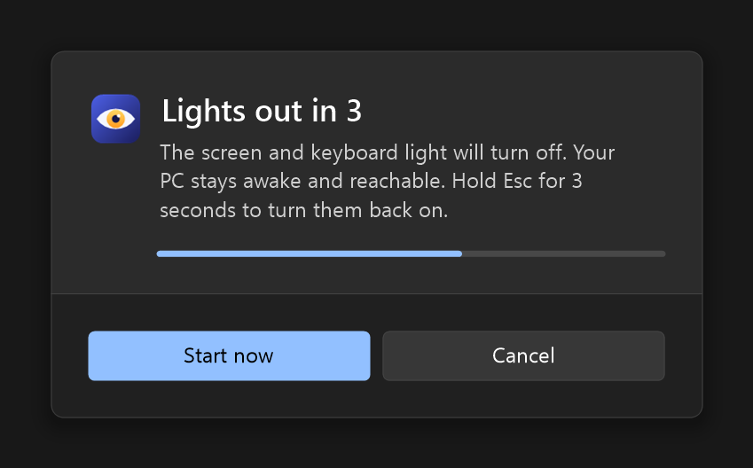
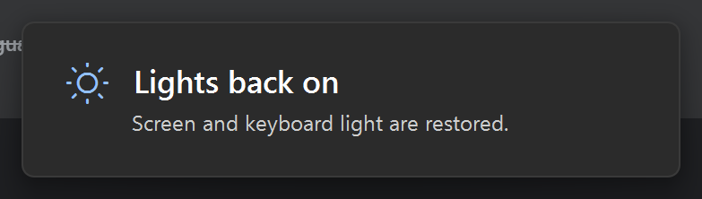

# WideAwake

A small Windows tray app that keeps your PC awake while it's plugged in, so you can still reach it over SSH, Remote Desktop or Tailscale, and a **Lights out** mode that darkens the screen and keyboard.

## Features

- **Keep awake while plugged in.** Stops Windows sleeping on AC power and lets it sleep normally on battery. Switches instantly when you plug in or unplug.
- **Lights out** (Ctrl+Alt+L, the tray menu, or double-click the tray icon):
  - A 5-second countdown card first. Press Enter or **Start now** to skip it, or Esc or **Cancel** to stop.
  - Covers every screen with black, hides the cursor and sets brightness to 0. Black pixels are off on OLED screens.
  - Turns the keyboard backlight off on ASUS laptops (through the ASUS ACPI driver installed with MyASUS).
  - Ignores all key presses.
  - **Hold Esc for 3 seconds** to exit (Ctrl+Alt+U also works). Brightness and keyboard light are restored, and a "Lights back on" card appears.
- **Start with Windows** option in the tray menu.

| Entering | Exiting |
| --- | --- |
|  |  |

### Why not just turn the display off?

On Modern Standby laptops (most recent ones), turning the display off with Windows' own command, or letting the screen timeout do it, puts the whole PC into standby, which cuts off network access. Lights out keeps the display technically "on" and blacks it out instead, so the PC stays reachable.

## Install

Download `WideAwakeSetup.exe` from the [latest release](https://github.com/kylepantall/WideAwake/releases/latest) and run it. It installs for the current user only, so it doesn't need admin rights. It installs to `%LOCALAPPDATA%\Programs\WideAwake`, adds a Start menu shortcut, and can optionally start with Windows and add a desktop shortcut.

To uninstall, go to **Settings → Apps → Installed apps → WideAwake**, or run `Uninstall.cmd`.

For scripted installs, `WideAwakeSetup.exe /silent` installs with the defaults and no window, and `WideAwake.exe /uninstall /quiet` removes it without asking.

### SmartScreen and antivirus warnings

The installer isn't code-signed yet, so Windows SmartScreen may warn you. Click **More info → Run anyway**.

Some antivirus products flag WideAwake as "potentially unwanted" because it does things that malware also does: it blocks keyboard input during Lights out, starts with Windows, and its installer writes a program to disk. If yours does, you can restore it from quarantine and add an exception, and please report it to your antivirus vendor as a false positive. The source code is all in this repository, so you can check exactly what it does.

## Build

You don't need to install any tools; it uses the C# compiler that comes with Windows (.NET Framework 4.x).

```bat
Build.cmd
```

This produces `WideAwake.exe` and `WideAwakeSetup.exe`, which has `WideAwake.exe` built in. `Build.cmd app` and `Build.cmd setup` build just one of them.

GitHub Actions ([`.github/workflows/build.yml`](.github/workflows/build.yml)) builds every push. Pushing a tag such as `v1.8` publishes a release with the installer attached; the tag must match `Version` in `Setup.cs`. Code signing through [SignPath Foundation](https://signpath.org) switches on once its repository secret and variables are set; the workflow file lists them.

## License

[MIT](LICENSE)

| File | What it is |
| --- | --- |
| `WideAwake.cs` | The tray app, Lights out mode, Fluent cards, ASUS keyboard light, and uninstaller (`/uninstall`) |
| `Setup.cs` | The setup wizard |
| `Build.cmd` | Builds both programs |
| `Uninstall.cmd` | Runs the installed uninstaller |
| `assets/logo.svg` | The logo source (256-unit grid) |
| `assets/MakeIcon.cs` | Renders the logo to `WideAwake.ico` and the PNGs, using the same geometry as the SVG |

To regenerate the icon after changing the design:

```bat
%WINDIR%\Microsoft.NET\Framework64\v4.0.30319\csc.exe /out:MakeIcon.exe /r:System.Drawing.dll assets\MakeIcon.cs
MakeIcon.exe assets
```
